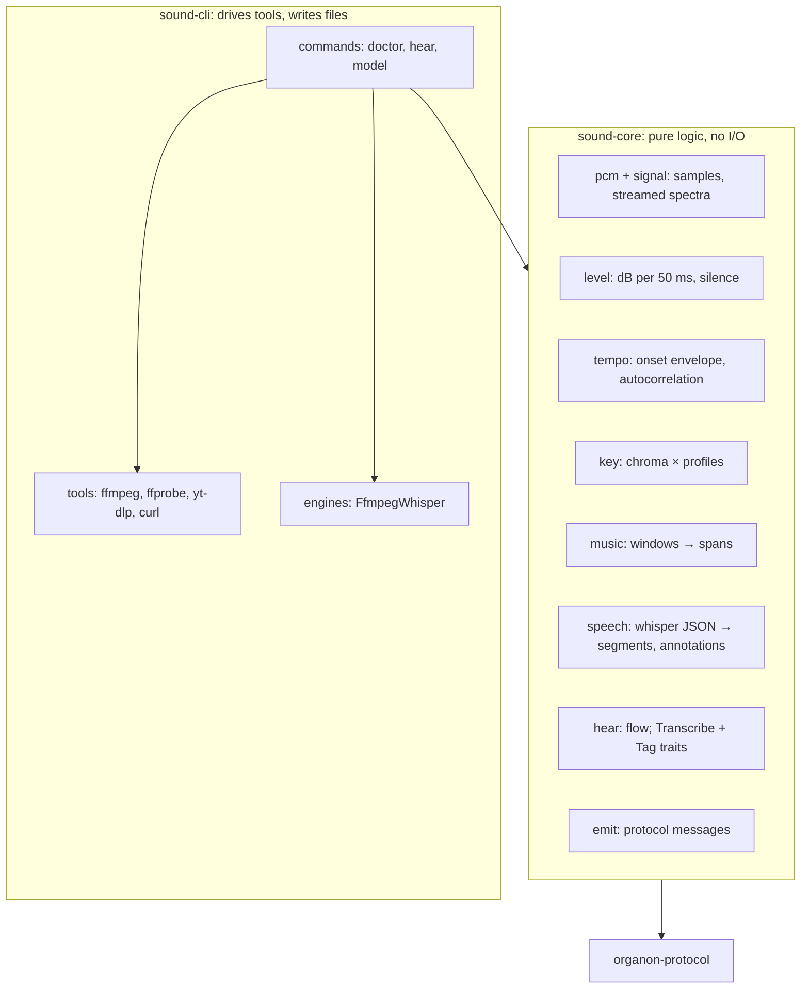

# organon-sound design

## Place in organon

Two levels of the three: **sense** (get the signal) and **perception** (located observations, no interpretation). What a recording *means* belongs to a reader and enters memory only as a proposal. This organ depends on `organon-protocol` and nothing else from organon.

`sound-core` never spawns processes, touches the network or prints, so all of it is tested on synthesized signals (click tracks, cadences, tone–gap–tone) and fake engines.

## Sense

| input | what happens | source id |
|---|---|---|
| YouTube URL | `yt-dlp -f ba` → `audio.<ext>`; title via `--print title` | `youtube:<id>`, the same as organon-video, so speech and pictures of one video are one source |
| other URL | the same, any site yt-dlp reads | `url:<url>` |
| organon-video folder | its `source.json` is reused as is. organon-video downloads a video-only stream, so when the video file has no audio the audio is fetched from the source's URL | the video's |
| file | read in place (not copied) | `file:<sha256 prefix>`, the same as organon-video |

## Perceive

Everything is decoded once by ffmpeg to 16 kHz mono `f32` (whisper's own rate; chroma stops at 2.1 kHz, so nothing is lost for key).

**Speech.** ffmpeg's `whisper` filter (ffmpeg 8+, whisper.cpp inside) writes JSON lines `{"start","end","text"}` in ms. Choices, each measured on this machine (ffmpeg 9.0.1, CPU, `ggml-base`, one minute of the test talk):

| setting | time for 60 s | used |
|---|---|---|
| `use_gpu=false` | 13 s | default |
| `use_gpu=true` (ffmpeg's default) | 21 s | `--gpu` |
| `vad_model=silero` | 120 s | `--vad` |

`queue=20`: ffmpeg's docs say 10–20 s passes are more accurate and cheaper than the 3 s default meant for live streams. The filter's timestamps count samples, which is right for files (the review concern about pts applies to live input). Two things it gets wrong, handled in `speech`:
- **Unescaped quotes.** ffmpeg 9.0.1 writes text without JSON escaping, so `says, "So you know…"` broke parsing on line 44 of the first real run. Lines that fail as JSON are read by their fixed layout (regression test).
- **Overlaps.** Consecutive chunks can overlap by a few ms (19.994 after 20.000); starts are clamped to the previous end.

Bracketed lines (`[Music]`, `(applause)`, `[BLANK_AUDIO]`, `♪`) are whisper saying what it heard but did not transcribe. They become `sound_event`s by the whisper engine, not transcript.

**Level and silence.** RMS per 50 ms in dBFS. Silence is below −50 dBFS for at least 2 s (shorter gaps are pauses).

**Tempo.** Onset envelope: log-magnitude spectral flux (64 ms frames, 10 ms hops), local mean (±0.25 s) removed, half-wave rectified. Tempo: the lag with the highest autocorrelation between 40 and 240 BPM, weighted by a log-normal prior around 120 BPM one octave wide, refined by parabolic interpolation. **Pulse** is the raw autocorrelation at that lag: near 1 for a click track, low for speech.

**Key.** Chroma: magnitudes of 65–2100 Hz bins (FFT of 0.5 s, ~2 Hz per bin) summed per pitch class, every 0.256 s. Key: Pearson correlation of the summed chroma with the 24 rotations of a major and minor profile; Krumhansl–Kessler by default (pop, general), Temperley with `--profile temperley` (classical). The result carries its correlation (`key_corr`) and its margin over the runner-up, because relative and fifth-related keys are close by nature.

**Sound events.** Three sources, each named in `produced_by`: silence (level), whisper's annotations, and a tagger behind the `Tag` trait. v0.1's tagger is **YAMNet** (521 AudioSet classes, mAP 0.306) as ONNX, run by **tract** (pure Rust, no native runtime), compiled once for 21-frame chunks that step by exactly 21 hops so frames tile without seams. A class is on in a frame at score ≥ 0.3; on-frames merge across one off-frame into an event with its best score. `Silence` is left to level, which places edges to 50 ms. The model is a community tf2onnx export (`audiomagic/yamnet-onnx`, weights unchanged per its card); `organon-sound model yamnet` fetches it, and without it tagging is skipped. The index groups overlapping events into moments with their top three labels and leaves out `speech` (the transcript has it); `messages.jsonl` keeps every event.

**Music.** 10 s windows every 5 s get level, tempo/pulse and key/correlation (`windows.tsv`). A window is music when it is louder than −45 dBFS and either tonal and pulsed (key r ≥ 0.6 and pulse ≥ 0.3) or very tonal on its own (r ≥ 0.8, for beatless intros and rubato); the evidence is below. Overlapping music windows merge into spans; spans under 10 s are dropped, and each span's tempo and key are measured again over all of it.

## Measured

All on one Windows machine (CPU), ffmpeg 9.0.1 (Gyan full build), whisper `ggml-base`, 2026-11-14.

**Speech, against a reference.** The test talk (Uncle Bob, *Dependency Inversion*, 12:51, manual English captions): whisper's text holds **1,642 of the 1,710 caption words in order (96.0%)**, counted as the longest common word sequence after lower-casing and removing punctuation. The whole hearing (decode, whisper, measures, YAMNet) took about 3 minutes, almost all of it whisper.

**Music detection.** 10 s windows; "pulse" and "r" as defined above.

| recording | kind | windows | pulse ≥ 0.3 | r ≥ 0.6 | music found |
|---|---|---|---|---|---|
| the talk | speech, 12:51 | 154 | 0 | 18 (max 0.71) | none |
| a narration | speech, 0:48 | 9 | 0 | 0 (mean 0.41) | none |
| 8 songs, scores and loops | music, 0:15–6:13, 26:19 in all | 2–74 each | most | almost all | 24:30 of 26:19 (93%); 4 of 8 in full, the lowest 4:10 of 5:14 |

Pulse never reached 0.3 in speech, while speech's key fit reached 0.71, so key fit alone at 0.6–0.7 would mark speech as music. The first rule (pulse and key) missed a song's 70 s intro without drums (pulse 0.1–0.2, r 0.8–0.96), which is why a window at r ≥ 0.8 counts on its own (regression test `a_beatless_tonal_pad_is_music`). That leaves a margin of 0.09 over the talk's highest window.

**Tempo and key, against librosa.** There is no ground truth for these recordings, so the check is an independent implementation: librosa 1.0.1 `feature.tempo` and Krumhansl profiles over librosa's CQT chroma (which estimates tuning).

| recording | tempo here | librosa | key here | librosa CQT + Krumhansl |
|---|---|---|---|---|
| song A | 142.3 | 143.6 | G minor | G minor |
| song B | 83.5 | 83.4 | Bb major | Eb major (a fifth) |
| song C | 105.9 | 107.7 | Bb major | G minor (relative) |
| score D | 89.9 / 67.5 (spans) | 136.0 | E minor | E minor |
| loop E (15 s) | 98.4 | 136.0 | C major | C major |

Tempo agrees within 2% on 3 of 5. The two disagreements are metre-level (3:2 and 2:1 against the spans), the known failure of this family of methods, and nothing here says which side is right. Key agrees exactly on 3 of 5; the other two are the fifth-related and relative confusions that MIREX scoring gives partial credit for.

**Sound events.** On the talk (an animated film with sound effects), YAMNet tagged 164 events in 45 moments in about 10 s. Spot checks against the transcript: 0:00–0:03 typing/typewriter before the first word at 3.8 s, and 7:07–7:15 typewriter/printer while the speaker says "reading from the keyboard reader and writing to the printer". Plausible, but **not checked by ear**, and many moments carry several co-firing labels from YAMNet's hierarchy (cattle, moo, livestock).

**Engine settings** (one minute of the talk): see the speech table above; VAD is 9× slower here, so it is opt-in.

## Known limits (next)

- **YAMNet is a starting tagger.** Distilled EfficientAT models reach mAP 0.483 against YAMNet's 0.306; one behind `Tag` is the next step. The 0.3 threshold and the label grouping are not yet checked by ear against labelled audio.
- **No word timestamps or speakers.** The filter gives segments only. whisper-rs (whisper.cpp bindings) would give word times; diarization is open.
- **Tempo octave and metre errors.** Known for this method above ~150 BPM; two of five songs disagree with librosa by 3:2-type ratios. A beat tracker would also give beat times.
- **Key without tuning estimation** (assumes A = 440 Hz), and no EDMA profile for electronic music.
- **No section structure** (verse, chorus) inside a music span yet: a novelty curve over chroma would give it.
- **Thresholds are tuned on a handful of recordings**, all on one machine.

## Prior art read before building

The organon-research run `tools-should-rust-sound-perception-organ` (11 claims, each with a verified passage; digested into memory under `concept:sound-perception`): ffmpeg's whisper filter docs and commit; Symphonia's codec table and speed; faster-whisper and whisper-rs; the Freesound Loop Dataset benchmark (Percival14 best on tempo; Essentia key algorithms best on key); Schreiber et al., "Music Tempo Estimation: Are We Done Yet?" (octave errors above 150 BPM); Essentia's key-profile notes; PANNs, YAMNet and EfficientAT on AudioSet; tract.
